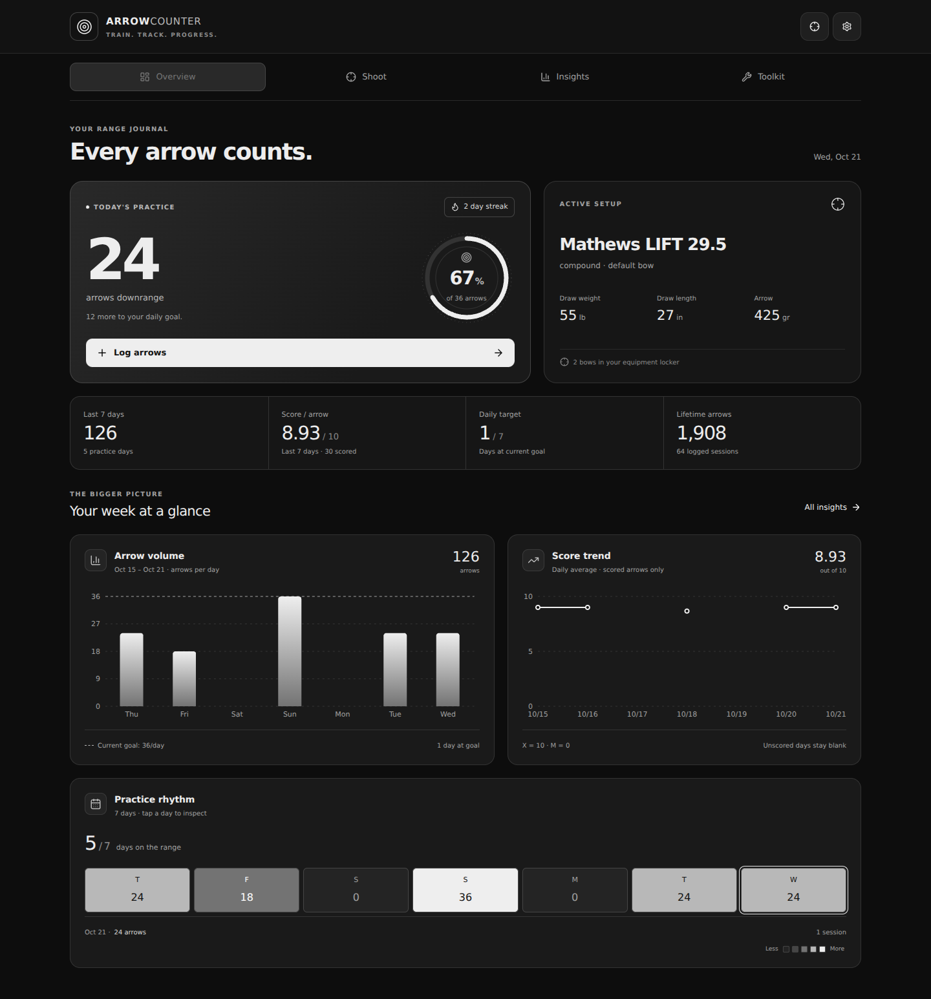
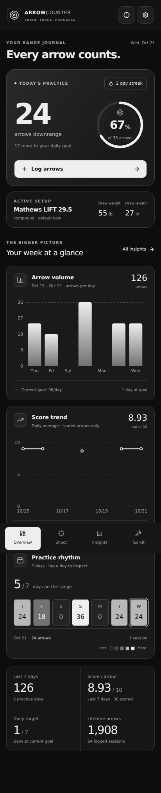
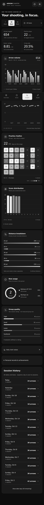

# Arrow Counter visual redesign

The UI follows the grayscale visual language of `Strobingn/Bowtune`: high-contrast surfaces, progress rings, visible measurements, and chart cards. It keeps the existing local data keys and Android application ID.

## Screens

- **Overview:** daily arrow count and goal ring, active bow, weekly volume, score trend, interactive practice calendar, and summary metrics. On phones the graphs appear before the secondary summary metrics.
- **Shoot:** persistent session draft, arrow counter, end scoring, bow/distance/group rating, notes, location, weather, undo/redo, and editable daily sessions. All score values from X to M are available. Saving an end updates the arrow count; a partially entered end is included when the session is logged.
- **Insights:** 7/30/90-day and bow filters; arrow volume, score trend, practice calendar, score distribution, distance breakdown, bow usage, and self-rated group quality. Expand the exact daily values, records, achievements, or session history. Older history loads in batches of 14 days.
- **Toolkit:** existing AI/tuning, competition, video, and media features. Heavy tools load when needed.

## Data rules

Charts only use saved sessions; there are no sample records in the application. X is worth 10, M is worth 0, and unentered scores are excluded. Score averages are weighted by scored arrows. Rest days remain in the date axis, and unscored days have gaps in the score line. Distance labels retain their original yards/meters units. Group quality is explicitly a self-rating, not a measured target grouping.

The current goal is used for every daily-goal comparison; past goal settings were not recorded. Today, charts, streaks, and history use local calendar days derived from the recorded timestamps. Original session timestamps and saved date fields are not migrated. The UI refreshes its date at midnight and when the phone resumes.

## Verification

- `npm run build`: TypeScript and production web build passed.
- `npm test`: 8 checks for score weighting, missing/zero scores, periods, filters, units, older UTC dates, DST, and empty data.
- Chromium production-build smoke checks: empty state; add/undo/redo; scoring; editing; reload persistence; date and bow filters; 360px, 412px, and 1440px layouts; toolkit navigation; Equipment sheet. No JavaScript runtime errors in these checks.
- New/reworked presentation components passed targeted ESLint. The existing achievement reconciliation effect in `useArrows` still triggers the repository's `react-hooks/set-state-in-effect` rule.
- Physical-device rendering, camera access, GPS, and external services still require device verification.

The Android workflow builds this branch as well as main/master and runs the chart checks. JDK 21 matches the existing Capacitor Android compile target. Android version is 1.1 (code 2).

## Screenshots

These screenshots show **seeded demonstration data in an isolated browser**, not the user's actual shooting records. The app itself starts with the user's existing saved data, or with an empty state.

| Desktop overview | Phone overview |
| --- | --- |
|  |  |

